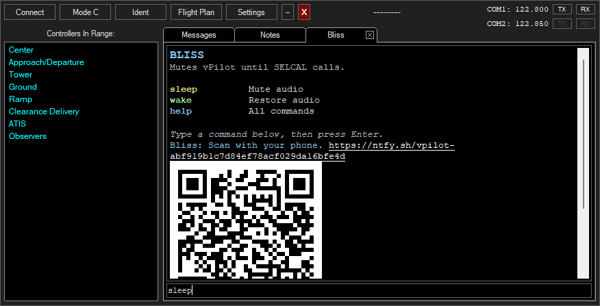
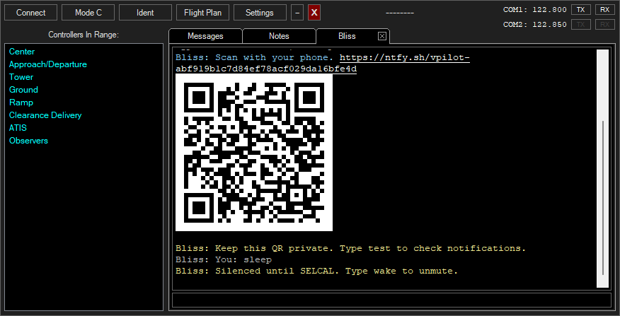
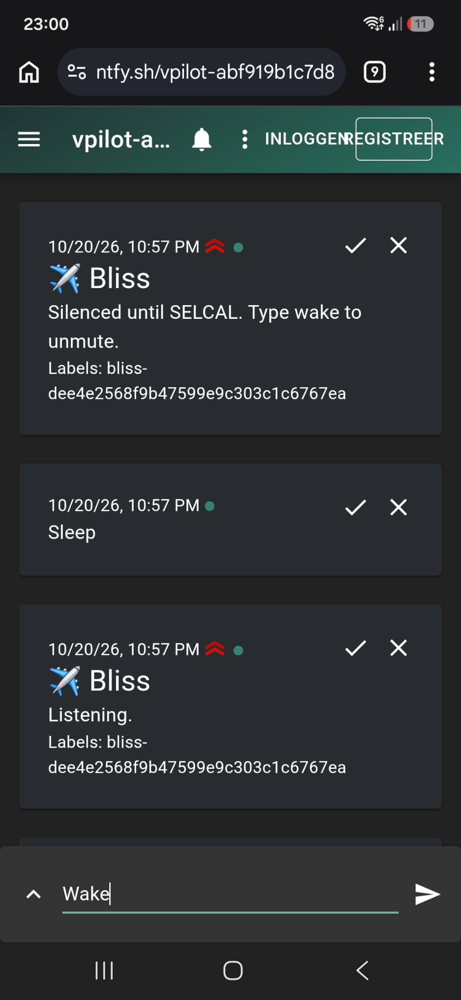

# vPilot Bliss

**Mutes vPilot until SELCAL calls.**

After installing vPilot-Bliss, you will see a new "Bliss" window in vPilot. When you are monitoring oceanic radio and you have confirmed your SELCAL code with ATC: Type: "sleep", and vPilot will be muted in Windows Audio Mixer. Any notification, private message, broadcast, ping and of course SELCAL alert, will instantly unmute vPilot again. When you change frequency or try to transmit while in sleep mode, Bliss will also wake-up vPilot and show a message indicating that vPilot was previously in sleep mode and that you forgot to turn it off.

On top of silencing vPilot oceanic static noise, Bliss sends notifications to your phone when you receive private messages, pings, notifications, etc. When you are in **uncontrolled** airspace, this allows you to go AFK while having your phone as a backup in case ATC goes online. Code of Conduct B3 (B) states only that you are not permitted to leave your connection unattended for extended period of time. I would interpret "an extended period of time" as not more than 10 minutes **for (previously) uncontrolled airspace**. I know that some controllers will wait up to 15/20 minutes when they go online on a new sector but it depends on the controller. Of course, once you see that a controller is online, or you see that you will be flying into controlled airspace, you are expected to respond immediately. 





## Install

**[⬇ Download the latest vPilot-Bliss.zip](https://github.com/sempostma/vpilot-bliss/releases/latest/download/vPilot-Bliss.zip)**

1. Download `vPilot-Bliss.zip` from the [Releases page](https://github.com/sempostma/vpilot-bliss/releases/latest) (under **Assets**), or use the direct link above.
2. Close vPilot.
3. Open `%LOCALAPPDATA%\vPilot\Plugins` (paste it into the Explorer address bar or the Run dialog, `Win + R`). Create the `Plugins` folder if it does not exist.
4. Extract the contents of the zip into that folder. You should end up with:
   ```
   %LOCALAPPDATA%\vPilot\Plugins\
   ├── vPilot.Bliss.dll
   └── Bliss.lib\
   ```
   Keep the `Bliss.lib` folder next to `vPilot.Bliss.dll`; do not extract into an extra subfolder.
5. Start vPilot. The **Bliss** tab appears in vPilot.

## Use

Open the **Bliss** chat tab inside vPilot:

- `sleep` mutes vPilot until SELCAL.
- `wake` restores audio manually.
- `status` shows whether audio is silenced.

`debug help` lists sound tests and simulated alerts; these are omitted from the welcome message.

Commands work in the Bliss tab and from your ntfy topic. No separate window opens.

Enter your SELCAL code when connecting to VATSIM. All vPilot audio is muted while silenced.

While sleeping, SELCAL, private messages, callsign mentions in radio text and network broadcasts unmute vPilot. Changing frequency or TX/RX selection, pressing PTT, or sending text also wakes it with a reminder sound. Bliss's extra alert sounds only play when waking from sleep; normal vPilot alerts are unchanged.

Experimental integration for **vPilot 3.12.1**; other versions are disabled.

## Notifications



1. Open the Bliss tab. A new ntfy session starts and its QR code appears automatically.
2. Subscribe on any of these devices:
   - **iOS / Android:** install [ntfy](https://ntfy.sh), scan the QR code, and subscribe to the topic in the app.
   - **Windows / macOS / Linux:** open the topic link in your browser and allow notifications. You can also [install the web app](https://docs.ntfy.sh/subscribe/pwa/).
3. Type `test` to check delivery. Close the Bliss tab to end the session.

Subscribe on multiple devices to alert them all. On desktop, generally keep your browser or web app running; see [ntfy's browser support](https://docs.ntfy.sh/subscribe/web/#background-notifications).

The welcome, commands and replies are mirrored to ntfy. Send `sleep`, `wake`, `help` or another listed command from your phone to control Bliss. Messages update every five seconds and are never sent to VATSIM. Closing the tab or vPilot ends the session; reopening creates a new topic to subscribe to.

Keep your topic private. Device sound and notification settings affect alerts.

## Keep alerting on Android

1. In ntfy, open **Settings → Notifications** and enable **Keep alerting for highest priority**.
2. In Bliss, type `test` to try it. SELCAL and test alerts use maximum priority.
3. Dismiss the notification or open the topic to stop the sound.

